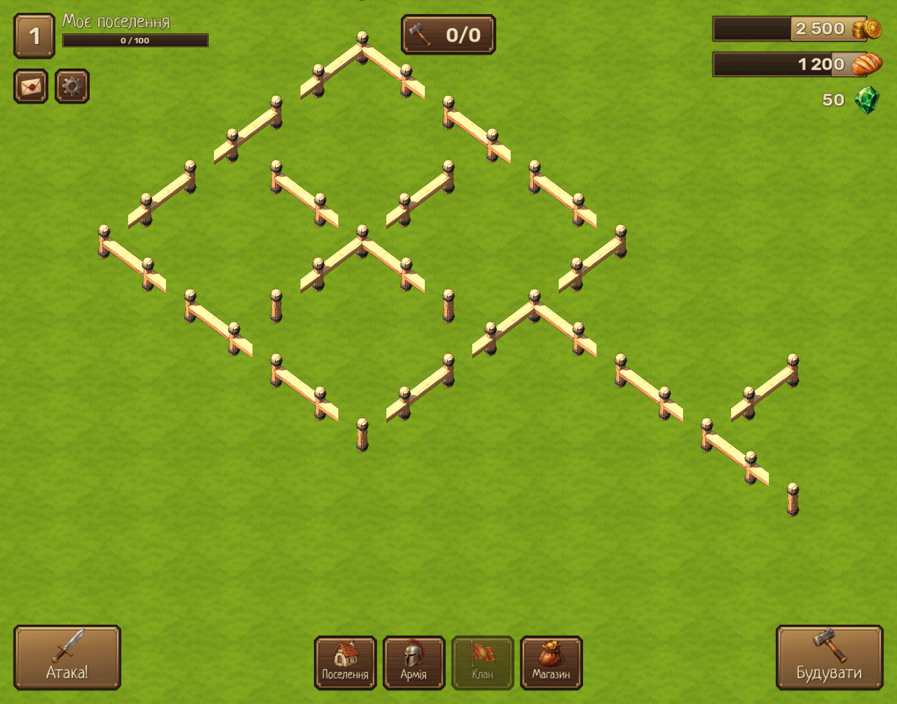

# Частокіл Lv.1: модульний 3D-паркан

Кожна секція займає одну клітинку 1×1. Схема користувача визначає з’єднання з чотирма сусідами квадратної сітки. У грі ця сітка показана ізометрично; діагональні клітинки не з’єднуються.

## Розміщення

- **W** (фізична клавіша, також Ц на українській розкладці) — увімкнути або вимкнути розміщення.
- **Лівий клік** — поставити секцію у вільну клітинку.
- **Shift + лівий клік** — прибрати секцію частоколу.
- **Esc** — завершити розміщення.
- Коліщатко та права кнопка миші керують наявною камерою.

Сітка показує зайняті клітинки; прозорий попередній перегляд показує майбутню секцію з урахуванням сусідів. Інші будівлі видалити цим інструментом не можна. Кожна поставлена секція блокує свою клітинку для ходьби й розміщення.

## Маски з’єднань

N = (0, −1), E = (+1, 0), S = (0, +1), W = (−1, 0). На екрані це верхній правий, нижній правий, нижній лівий та верхній лівий напрямки.

Для кожного сусіда встановлюється біт: N = 1, E = 2, S = 4, W = 8. Сума визначає маску з’єднань. Повний набір із 16 варіантів охоплює дев’ять прикладів на схемі та решту потрібних поворотів і розгалужень.

| Маска | Секція |
| --- | --- |
| 0 | Окремий стовп |
| 1 | Кінець N |
| 2 | Кінець E |
| 3 | Кут N+E |
| 4 | Кінець S |
| 5 | Пряма N+S |
| 6 | Кут E+S |
| 7 | Трійник N+E+S |
| 8 | Кінець W |
| 9 | Кут N+W |
| 10 | Пряма E+W |
| 11 | Трійник N+E+W |
| 12 | Кут S+W |
| 13 | Трійник N+S+W |
| 14 | Трійник E+S+W |
| 15 | Перехрестя |

Паркан тепер має два окремі GLB-ресурси з PBR-матеріалом і вбудованими текстурами: `assets/buildings/palisade/fence_post.glb` — один стовп, `assets/buildings/palisade/fence_beam.glb` — повна перекладина між сусідніми вузлами. Вони зібрані зі спрощеної вихідної моделі скриптом `tools/split_palisade_models.gd`; разом займають близько 6 МБ. У кожній зайнятій клітинці малюється рівно один стовп, а ребро з’єднання створює одну перекладину. У грі кожен паркан володіє лише ребрами на схід і південь, тож жодна пара сусідів не створює балку двічі. Курсор розміщення показує всі чотири напрямки, включно з північчю та заходом. Камера повторює ізометричну проєкцію карти 96:72, а довжина балки дорівнює кроку сітки.

`wooden_cross_post.glb` залишено як вихідник для повторного розділення; під час гри завантажуються лише два модульні GLB.

PNG-варіанти, створені раніше, залишено в каталозі як старі ресурси, але гра їх більше не завантажує. PNG-мініатюра з моделі використовується лише в картці каталогу.

Стовпи стоять безпосередньо на траві, без окремої PNG-підкладки ґрунту. Вибір секції та попередній перегляд розміщення використовують ту саму пару модулів і масштаб.

`VillageMap` обчислює з’єднання після відновлення зайнятих клітинок. При додаванні, прибиранні, зміні `cell` або прямому видаленні вузла оновлюються також сусідні секції. `VillageBuilding` вибирає рендер маски, коли змінюється сусідство.

## Генерація та перевірка



Це знімок справжньої сцени Godot з тестовим замкненим контуром, кінцевими секціями, трійником і перехрестям. Його відтворює `tools/palisade_preview.gd`; тестова розстановка не додається у стартову базу.

`tests/palisade_test.gd` перевіряє всі 16 масок, взаємне з’єднання сусідів, наявність 3D-візуалу, видалення й переміщення, межі карти, зайняті клітинки, навігацію та керування через події вікна. Запуск:

```powershell
Godot_v4.7.2-stable_win64_console.exe --headless --path . --script tests/palisade_test.gd
```

